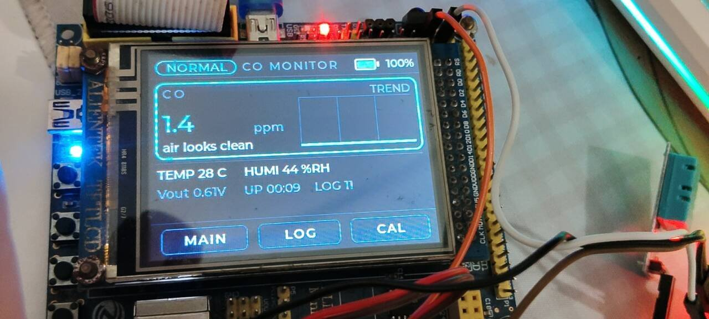

# 便携式气体检测仪 · Portable Gas Detector

基于 **STM32F103 + LVGL 8.2** 的手持式检测仪：实时监测**一氧化碳（CO）**浓度，同步显示**环境温湿度**与**电池电量**，超限时声光报警并把事件写入片上 EEPROM，掉电不丢。



> 上图为实机运行状态：CO 浓度 1.4 ppm、温度 28 ℃、湿度 44 %RH、电量 100 %、已记录 11 条日志。

---

## 目录

- [功能特性](#功能特性)
- [硬件清单](#硬件清单)
- [快速开始](#快速开始)
- [接线说明](#接线说明)
- [界面说明](#界面说明)
- [使用指南](#使用指南)
- [技术规格](#技术规格)
- [项目结构](#项目结构)
- [已知限制](#已知限制)
- [后续可以做什么](#后续可以做什么)

---

## 功能特性

| 功能 | 说明 |
|---|---|
| **CO 浓度实时监测** | MQ-7 传感器 + 12 位 ADC 采样，四步换算（电压 → Rs → Rs/R0 → ppm），带一阶低通滤波 |
| **温湿度显示** | DHT11 单总线传感器，2 秒刷新一次 |
| **分级报警** | 预警 / 报警双阈值，带**迟滞**与**3 秒持续时间确认**，避免误报和阈值抖动 |
| **声光提示** | 板载 LED 按状态变频闪烁（预热慢闪 / 预警中速 / 报警急促） |
| **报警日志** | 32 条环形缓冲写入 24C02 EEPROM，掉电不丢；界面可翻看最近 6 条 |
| **电池电量** | 电阻分压 + ADC 采样，按锂电池放电曲线查表换算百分比，低电量变色提示 |
| **触摸交互** | 电阻触摸屏，三个功能键，界面支持翻页 |
| **传感器标定** | 一键在洁净空气中标定 R0，标定值存入 EEPROM |

---

## 硬件清单

| 类别 | 型号 / 规格 | 数量 | 备注 |
|---|---|---|---|
| 主控板 | 正点原子 MiniSTM32 V3（**STM32F103RCT6**，256KB Flash / 48KB RAM） | 1 | 必须是 RC 及以上，C8T6 装不下 |
| 显示屏 | 2.8 寸 TFT（ILI9341，320×240，**电阻触摸**） | 1 | 正点原子 TFT 模块，直插排座 |
| 气体传感器 | **MQ-7**（一氧化碳）模块 | 1 | 5V 供电，模拟输出 |
| 温湿度传感器 | **DHT11** | 1 | 需 4.7k~10k 上拉电阻 |
| 存储 | **24C02** EEPROM | 1 | 开发板板载，无需外接 |
| 调试器 | ST-Link V2 | 1 | 烧录与调试 |
| 电源 | 5V USB 电源 / 充电宝 | 1 | 便携使用时用充电宝 |

> ⚠️ **MQ-7 加热丝功耗约 150mA**，加上屏幕背光整机约 400mA。供电不足会导致屏幕发暗或单片机反复复位，请使用带独立供电的 USB 口或充电宝。

---

## 快速开始

### 1. 环境要求

| 工具 | 版本 / 路径 | 用途 |
|---|---|---|
| Keil MDK ARMCC | `D:\apps\keil5MDK\ARM\ARMCC\bin` | 编译器 |
| GNU Make | 仓库同级 `..\.tools\make\make.exe` | 构建 |
| pyOCD | `C:\Users\<用户名>\.pyocd-venv\Scripts\pyocd.exe` | 烧录 |
| Arm GNU Toolchain | 12.2 及以上 | 调试（可选） |

### 2. 编译

```bat
cd /d <项目根目录>
build.bat              :: 增量编译，产物在 build\GasDetector.hex
build.bat clean        :: 清理后重新编译（改了 .h 必须这样做）
build.bat DEBUG=1      :: 带调试信息
```

> **重要**：本项目 Makefile 没有头文件依赖规则。**修改任何 `.h`（尤其是 `lv_conf.h`）后必须 `build.bat clean` 再编译**，否则改动不会生效。

### 3. 烧录

```powershell
C:\Users\<用户名>\.pyocd-venv\Scripts\pyocd.exe load -t stm32f103rc build\GasDetector.hex
```

在 VS Code 中也可以直接运行任务 `Flash (pyOCD + ST-Link)`（编译 + 烧录一条龙），或按 `F5` 进入调试。

👉 **首次使用请阅读 [烧录与调试指南](docs/FLASH_GUIDE.md)**，里面有接线、串口查看和排错对照表。

### 4. 首次上电

因为使用电阻屏，第一次上电会先进入**触摸校准**流程（屏幕上依次出现 4 个十字光标）。用手指或触控笔**逐个点准十字中心**，校准参数会存入 EEPROM，之后开机不再询问。

校准完成后进入主界面，此时状态显示 `WARM UP`，**需要等待 3 分钟预热**（详见[使用指南](#使用指南)）。

---

## 接线说明

### MQ-7 气体传感器

| MQ-7 引脚 | 接到 | 说明 |
|---|---|---|
| VCC | **5V** | ⚠️ 必须 5V，接 3.3V 会因电流不足导致设备异常 |
| GND | GND | |
| AO | **PA1** | 模拟输出，接 ADC1_IN1 |
| DO | 不接 | 模块内置电位器阈值输出，本方案使用软件阈值 |

### DHT11 温湿度传感器

| DHT11 引脚 | 接到 | 说明 |
|---|---|---|
| VCC | 3.3V | |
| DATA | **PA3** | 需在 DATA 与 VCC 之间加 **4.7k~10k 上拉电阻** |
| GND | GND | |

> 很多 DHT11 模块出厂未焊上拉电阻，若不添加，读数会持续失败。

### 电池电量检测

```
电池正极 ──[ R1 100k ]──┬──[ R2 100k ]── GND
                        │
                        └── PA2 (ADC1_IN2)
```

两个等值电阻将电池电压对半分开（4.2V → 2.1V），确保落在 ADC 的 3.3V 量程内。

### 引脚占用总览

```
PA0  KEY2              PA1  MQ-7 AO          PA2  电池分压        PA3  DHT11
PA4~PA7  空闲（可扩展 4 路模拟传感器）        PA8  LED0            PA9/PA10  串口1
PA13/PA14  SWD 调试                          PA15  KEY1
PB0~PB15  TFT 数据线（16 位并口）
PC0~PC3  电阻触摸      PC5 KEY0              PC6~PC10  TFT 控制
PC11/PC12  24C02 EEPROM
```

> **注意**：2.8 寸屏的数据线使用 PB3/PB4，这两个引脚默认是 JTAG 功能。程序在初始化屏幕前调用 `KEY_Init()` 释放它们（内部执行 `GPIO_Remap_SWJ_JTAGDisable`），否则会出现花屏。

---

## 界面说明

界面为深色仪表盘风格，分为三个区域：

```
┌──────────────────────────────────────────────────────────┐
│ [状态胶囊]        CO MONITOR           [电池图标] 100%   │  状态栏
├──────────────────────────────────────────────────────────┤
│  ┌────────────────────────────────────────────────────┐  │
│  │ CO                              ┌ TREND ────────┐  │  │
│  │ 1.4        ppm                  │  实时曲线     │  │  │  读数卡
│  │ air looks clean                 └───────────────┘  │  │
│  └────────────────────────────────────────────────────┘  │
│  TEMP 28 C      HUMI 44 %RH                              │
│  Vout 0.67V     UP 00:09      LOG 11                     │
├──────────────────────────────────────────────────────────┤
│      [  MAIN  ]      [  LOG  ]      [  CAL  ]            │  功能键
└──────────────────────────────────────────────────────────┘
```

| 元素 | 说明 |
|---|---|
| **状态胶囊** | 设备当前状态，颜色随状态变化（见下表） |
| **CO 读数** | 大字号实时浓度值，单位 ppm；预热期间显示剩余秒数 |
| **TREND 曲线** | 最近 40 次采样的浓度趋势，颜色跟随状态变化 |
| **TEMP / HUMI** | 环境温度与相对湿度 |
| **Vout** | MQ-7 输出电压，用于判断接线与标定是否正常 |
| **UP** | 开机运行时长（分:秒），同时作为日志时间戳 |
| **LOG** | EEPROM 中累计的日志条数 |
| **电池图标** | 电量百分比，低电量时变为红色 |

### 状态说明

| 状态 | 颜色 | 含义 | LED 表现 |
|---|---|---|---|
| `WARM UP` | 蓝 | 传感器预热中，此时不报警 | 慢闪（1 秒） |
| `NORMAL` | 青 | 浓度正常 | 常亮 |
| `WARNING` | 橙 | 浓度超过预警阈值（25 ppm） | 中速闪（0.4 秒） |
| `ALARM` | 红 | 浓度超过报警阈值（50 ppm）并持续 3 秒 | 急促闪（0.2 秒）+ 卡片呼吸光效 |
| `SENSOR ERR` | 灰 | 传感器读数异常（如未接线、量程饱和） | 慢闪 |

---

## 使用指南

### 首次使用：必须做的三步

**第一步：预热**

上电后状态显示 `WARM UP`，界面倒计时 180 秒。这期间读数不可信，设备也不会报警。请等待状态变为 `NORMAL`。

> MQ-7 是半导体传感器，**全新传感器建议首次连续通电 24~48 小时**进行老化，之后读数会更稳定。日常使用每次开机预热 3 分钟即可。

**第二步：标定（关键步骤）**

MQ-7 个体差异较大，不标定则读数没有参考意义。

1. 确认状态已是 `NORMAL`（预热完成）
2. 把设备放到**洁净空气**中：室外通风处，或刚开过窗的房间
   - ❌ 不能有：酒精、香水、香烟、燃气灶、汽车尾气
3. 点击屏幕下方的 **`CAL`** 键
4. 标定完成后，主界面的 `R0` 数值会更新，并自动写入 EEPROM（掉电不丢）

> ⚠️ **在有污染的环境中点击 `CAL` 会导致标定错误**，之后所有读数都会偏低（该报警时不报警）。如果不慎误操作，请到洁净空气中重新标定。

**第三步：验证**

对着传感器轻轻哈一口气，CO 读数应当有明显变化，说明整条链路工作正常。

### 日常操作

| 按键 | 功能 |
|---|---|
| **MAIN** | 返回主界面（读数、温湿度、电量、曲线） |
| **LOG** | 查看日志页：最近 6 条报警记录（时间、CO 值、温度、事件类型） |
| **CAL** | 在洁净空气中重新标定 R0 |

日志页格式示例：

```
TIME    CO    T   EVENT
  0:01   62   26  CO ALARM
  0:00    0   26  power on
  ---- total 2 records ----
```

`TIME` 表示开机后经过的时间（分:秒）。设备没有 RTC 电池，关机后计时归零。

### 报警阈值

| 项目 | 阈值 | 说明 |
|---|---|---|
| 预警 | 25 ppm | 超过时状态变为橙色 |
| 预警解除 | 18 ppm | 迟滞设计，避免在阈值附近反复跳变 |
| 报警 | 50 ppm | 超过并**持续 3 秒**才确认，避免瞬时干扰误报 |
| 报警解除 | 40 ppm | 迟滞设计 |

### 省电与便携使用

设备整机功耗约 400mA（主要来自 MQ-7 加热丝和屏幕背光），**可以直接用充电宝供电**：

- 优先使用充电宝的 **USB-A 输出口**（稳定 5V）
- ❌ 避免使用带快充协议的 Type-C 口，可能输出 9V/12V 损坏设备
- 若充电宝有"无负载自动关机"功能且频繁断电，请切换到小电流模式
- **使用充电宝供电时请拔掉 ST-Link**，两者同时供电会互相冲突

---

## 技术规格

| 项目 | 参数 |
|---|---|
| 主控 | STM32F103RCT6，Cortex-M3 @72MHz |
| Flash 占用 | 244.1 KB / 256 KB（含 LVGL 与中文字库外全部资源） |
| RAM 占用 | 37.1 KB / 48 KB（LVGL 堆 24KB + 绘制缓冲 6.25KB + 栈 2KB） |
| 显示 | 2.8 寸 TFT，320×240，16 位色 |
| 图形库 | LVGL 8.2.0 |
| 采样周期 | 传感器 100ms / 界面刷新 200ms |
| CO 量程 | 0 ~ 2000 ppm（MQ-7 有效区间约 20 ~ 2000 ppm） |
| CO 精度 | 参考值（民用传感器，误差约 ±30%，建议关注趋势而非绝对值） |
| 日志容量 | 32 条（环形缓冲，写满后覆盖最旧记录） |
| 功耗 | 约 400mA @5V（MQ-7 加热 150mA + 背光 150mA + 主控 60mA） |

---

## 项目结构

```
02-GasDetector/
├─ README.md                  本文件
├─ docs/                      文档
│  ├─ USER_GUIDE.md             使用手册（功能操作详解）
│  ├─ DEVELOPER_GUIDE.md        开发文档（架构、算法、移植、排错）
│  ├─ FLASH_GUIDE.md            烧录调试零基础教程
│  └─ images/                   效果图
├─ USER/
│  └─ main.c                  主程序入口
├─ HARDWARE/
│  ├─ GAS/                    ADC 底座 + MQ-7 驱动
│  ├─ DHT11/                  温湿度传感器驱动
│  ├─ BATT/                   电池电量检测
│  ├─ EEPROM/                 24C02 存储与日志
│  ├─ APP/
│  │  ├─ gas_app.c              业务逻辑（采样、报警、日志）
│  │  └─ ui_gas.c               LVGL 界面
│  ├─ LCD/ TOUCH/ IIC/ 24CXX/ KEY/ LED/ TIMER/    底层驱动
├─ LVGL/
│  └─ GUI/lvgl/               LVGL 8.2.0 图形库与移植层
├─ STM32F10x_FWLib/           STM32 标准外设库 V3.5
├─ CORE/ SYSTEM/              CMSIS 内核与系统层
├─ OBJ/                       分散加载文件（链接必需）
├─ Makefile / build.bat       构建脚本
└─ .vscode/                   VS Code 构建、烧录、调试配置
```

---

## 已知限制

本项目为学习与实践作品，请在了解以下限制的前提下使用：

| 限制 | 说明 |
|---|---|
| **仅支持 CO 检测** | MQ-7 是一氧化碳专用传感器，**无法检测可燃气体（甲烷/液化气）、甲醛或氧气**。如需这些检测项，请更换对应传感器并参考 CO 通道的扩展方式 |
| **读数仅供参考** | 民用级传感器，个体差异与漂移较大。**不可用于人身安全、燃气泄漏判断等场景**，请使用经过计量认证的专业仪器 |
| **无绝对时间** | 板载无 RTC 电池，日志时间戳为"开机运行时长" |
| **界面为英文** | Flash 剩余空间不足以容纳中文字库（详见开发文档） |
| **无蜂鸣器** | MiniSTM32 板载无蜂鸣器，报警提示使用 LED 闪烁，需要声音可外接蜂鸣器 |
| **DHT11 读取阻塞** | 单总线时序需要约 22ms 阻塞等待，每 2 秒一次，对界面流畅度影响可忽略 |

---

## 后续可以做什么

按难度从低到高排列，代码中已预留接口：

| 方向 | 说明 |
|---|---|
| 加装蜂鸣器 | 空闲引脚（PC4 / PB5）接有源蜂鸣器，在状态机中调用 |
| 日志导出 | 通过串口 1 将 EEPROM 日志输出为 CSV 格式 |
| 温度补偿 | 使用 DHT11 的温度值修正 CO 读数（半导体传感器受温度影响明显） |
| 增加检测项 | PA4~PA7 是空闲的 ADC 通道，可接入 MQ-2（可燃气体）、甲醛等模块 |
| 中文界面 | 需要精简 Flash 占用后启用 CJK 字库 |
| 锂电池供电 | 18650 + 升压模块 + 充电管理，做成真正的手持设备 |
| 低功耗模式 | 空闲时进入 STOP 模式，按键唤醒 |

---

## 文档索引

| 文档 | 内容 |
|---|---|
| [使用手册](docs/USER_GUIDE.md) | 功能详解、标定流程、常见问题 |
| [开发文档](docs/DEVELOPER_GUIDE.md) | 软件架构、算法原理、构建说明、排错指南 |
| [烧录指南](docs/FLASH_GUIDE.md) | 零基础烧录教程、接线检查、错误对照表 |

---

## 致谢

- LVGL 图形库：<https://lvgl.io>
- 正点原子 MiniSTM32 开发板与底层驱动
- STMicroelectronics STM32 标准外设库
